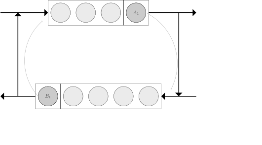

.. _detect-deadlock:

======================
How to Detect Deadlock
======================

Deadlock is the phenomenon whereby all movement and customer flow in a restricted queueing network ceases, due to circular blocking.
The diagram below shows an example, where the customer at the top node is blocked to the bottom node, and the customer at the bottom node is blocked to the top node.
This circular blockage results is no more natural movement happening.

HCiw's has built in deadlock detection capability.
With HCiw, a queueing network can be simulated until it reaches deadlock.
HCiw then records the time until deadlock from each state.
(Please see the documentation on :ref:`state trackers <state-trackers>`.)

In order to take advantage of this feature, set the :code:`deadlock_detection` argument to one of the deadlock detection methods when creating the Simulation object.
Currently only :code:`hciw.deadlock.StateDigraph` is implemented.
Then use the :code:`simulate_until_deadlock` method.
The attribute :code:`times_to_deadlock` contains the times to deadlock from each state.

Consider the :ref:`M/M/1/3 <kendall-notation>` queue where customers have probability 0.5 of rejoining the queue after service.
If the queue is full then that customer gets blocked, and hence the system deadlocks.

Parameters::

    >>> import hciw
    >>> N = hciw.create_network(
    ...    arrival_distributions=[hciw.dists.Exponential(rate=6.0)],
    ...    service_distributions=[hciw.dists.Exponential(rate=5.0)],
    ...    routing=[[0.5]],
    ...    number_of_servers=[1],
    ...    queue_capacities=[3]
    ... )

Running until deadlock (using a :code:`hciw.trackers.NaiveBlocking` object)::

    >>> import hciw
    >>> hciw.seed(1)
    >>> Q = hciw.Simulation(N,
    ...     deadlock_detector=hciw.deadlock.StateDigraph(),
    ...     tracker=hciw.trackers.NaiveBlocking()
    ... )
    >>> Q.simulate_until_deadlock()
    >>> Q.times_to_deadlock # doctest:+SKIP
    {((0, 0),): 0.94539784..., ((1, 0),): 0.92134933..., ((2, 0),): 0.68085451..., ((3, 0),): 0.56684471..., ((3, 1),): 0.0, ((4, 0),): 0.25332344...}

Here the keys correspond to states recorded by the state tracker. Note in order for :code:`times_to_deadlock` to be meaningful, a state tracker must be used.
